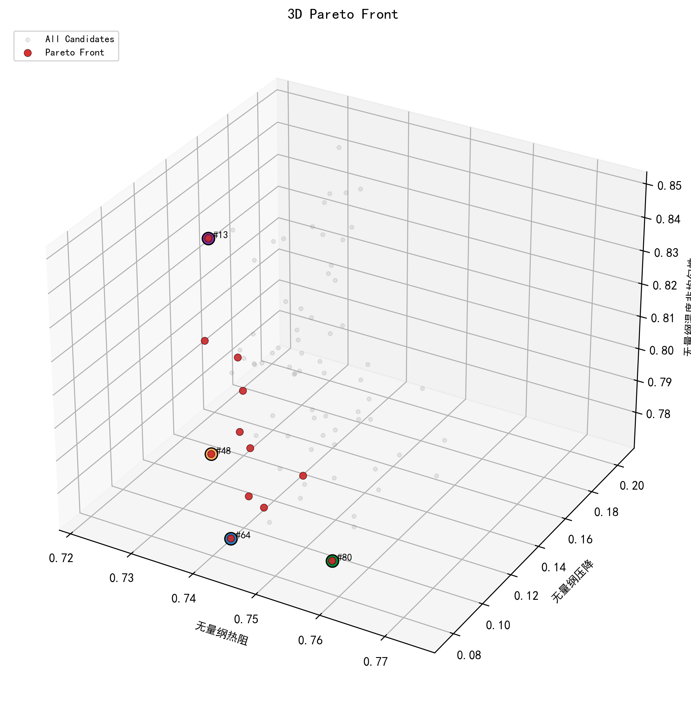

# Mathematical Modeling and Optimization

A computational modeling project on high-performance chip thermal management. The workflow compares manifold and pin-fin designs across thermal resistance, pressure drop, and temperature nonuniformity.

[Personal website](https://gaoshiqing.space) · [Project write-up](https://gaoshiqing.space/projects/mathematical-modeling-optimization/)



## Methods

1. Clean the performance data and explore main effects and correlations. The original experiment contains 84 samples, including 80 enhanced pin-fin designs used for the common normalization reference.
2. Compare surrogate models by cross-validation. The selected models are Gaussian process regression for thermal resistance and temperature nonuniformity, and a cubic ridge response surface for pressure drop.
3. Compare observed designs and search surrogate predictions using Pareto filtering, equal-weight scoring, and TOPSIS.
4. Test recommendations under alternative objective weights, random weight sampling, manufacturing perturbations, discrete pin-row changes, and approximate flow-rate changes.

## Findings

Sample **#64** (`x = (0.20, 4.50, 4)`) is the nominal recommendation and leads under criteria favoring average performance or frequency of being best. **#48** is an alternative under weight-robustness criteria emphasizing low variability or tail risk. **#14** is a reference for manufacturing variability at higher pin-row counts. The manufacturing Monte Carlo and the random-weight analysis represent separate sources of uncertainty.

The flow-rate analysis uses engineering approximations. The results depend on the supplied design space, the normalization, objective weights, and perturbation assumptions.

## Reproduction

Use Python 3.12 and install the dependencies from the repository root.

```sh
python -m pip install -r requirements.txt
```

Review selected derived tables and figures directly under `outputs/`. For a full rerun, supply the original performance workbook separately at `data/raw/附件2_性能数据.xlsx` and run `python run_all.py`. After the full run generates the cleaned data and trained models, run `python run_phase5_common_norm.py` to reproduce the sample-level common-normalization manufacturing analysis. The original competition inputs and submission files are kept outside this repository.

| Directory | Contents |
| --- | --- |
| `src/` | Data processing, surrogate models, optimization, robustness and plotting |
| `outputs/tables/` | Selected derived results |
| `outputs/figures/` | Selected figures |
| `outputs/models/` | Model-selection summary and the three fitted surrogates |
